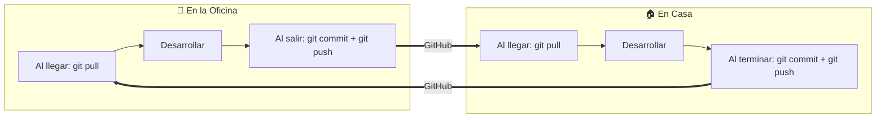

# 🖥️ Control y Sincronización de Equipos: Casa ↔ Oficina

Este documento registra los equipos de trabajo utilizados para el desarrollo de **operadora-taquilla-web** y define el protocolo de sincronización continua entre el equipo de **Casa** y el de la **Oficina**.

---

## 📌 1. Registro de Equipos

| Propiedad | 🏠 Equipo Casa | 🏢 Equipo Oficina (Este Equipo) |
| :--- | :--- | :--- |
| **Identificador** | `PC-CASA` | `PC-OFICINA` |
| **Hostname Windows actual** | `EdgarOffice` | `ANDYS-PC` |
| **Usuario Windows** | `Edgar Office` | `andyf` |
| **Ruta del Proyecto** | `C:\Users\Edgar Office\Downloads\operadora-taquilla-web-main` | `c:\Users\andyf\Downloads\operadora-taquilla-web-main` |
| **Rol habitual** | Desarrollo nocturno, pruebas y ajustes remotos | Desarrollo principal en jornada laboral |
| **Rama Git principal** | `main` | `main` |
| **Repositorio Remoto** | `https://github.com/andyfuenmayor-droid/operadora-taquilla-web.git` | `https://github.com/andyfuenmayor-droid/operadora-taquilla-web.git` |

---

## 🏷️ 2. Cómo Renombrar Cada Equipo

### A. Renombrar en Windows (Nombre de Red / Sistema)
> ⚠️ **Nota:** Cambiar el nombre en Windows requiere permisos de **Administrador**.

#### En Casa (`PC-CASA`):
1. Abre **PowerShell como Administrador**.
2. Ejecuta:
   ```powershell
   Rename-Computer -NewName "PC-CASA"
   ```
3. Reinicia la computadora cuando sea conveniente para que tome el nuevo nombre.

#### En la Oficina (`PC-OFICINA`):
1. Abre **PowerShell como Administrador** en el equipo de la oficina.
2. Ejecuta:
   ```powershell
   Rename-Computer -NewName "PC-OFICINA"
   ```
3. Reinicia el equipo al terminar la jornada.

---

### B. Identificación Local del Proyecto (Sin reiniciar)
Para que el entorno identifique inmediatamente dónde estás parado, usamos el archivo local `.workstation` (ignorado en `.gitignore`):
- En la Oficina:
  ```text
  MI-OFICINA
  ```
- En Casa:
  ```text
  MI-CASA
  ```

---

## 🔄 3. Regla de Oro para Trabajar entre Casa y Oficina (Cero Conflictos)

Para evitar desincronizaciones o conflictos de código al moverte de un lugar a otro, sigue religiosamente estos 2 pasos:



### ☀️ Paso 1: Al Empezar tu Jornada (En Casa o en Oficina)
Siempre antes de escribir una sola línea de código:
```bash
# 1. Asegúrate de estar en main y sin cambios sueltos
git status

# 2. Descarga lo último que subiste desde el otro equipo
git pull origin main
```

### 🌙 Paso 2: Al Terminar tu Jornada (Antes de Salir de la Oficina o Ir a Dormir)
Siempre antes de cambiar de equipo:
```bash
# 1. Revisa los archivos modificados
git status

# 2. Agrega y sube los cambios
git add .
git commit -m "feat/fix: [descripción de lo que avanzaste]"
git push origin main
```

---

## 🔐 4. Variables de Entorno (`.env`)
- El archivo `.env` está en `.gitignore` por seguridad para no exponer credenciales en GitHub.
- **Importante:** Si agregas una variable nueva a `.env` en la oficina, asegúrate de replicarla en el `.env` de casa (y viceversa).

---

## 📋 5. Historial de Sincronizaciones

| Fecha | Equipo | Acción Realizada | Commit / Estado |
| :--- | :--- | :--- | :--- |
| **14/10/2026** | 🏢 Oficina | DateRangeReportTab con métricas multi-moneda y filtros de supervisor, operationalDashboard | Commits `9da20b4`, `ded927c` |
| **18/10/2026** | 🏢 Oficina | Fix selección reactiva de cuenta destino en transferencias bancarias | Commit `8174da7` |
| **21/10/2026** | 🏢 Oficina | Verificación de sincronización con `origin/main` (al día), asignación de `.workstation` (`MI-OFICINA`) y registro de control. | Sincronizado a `8174da7` (`MI-OFICINA`) |
